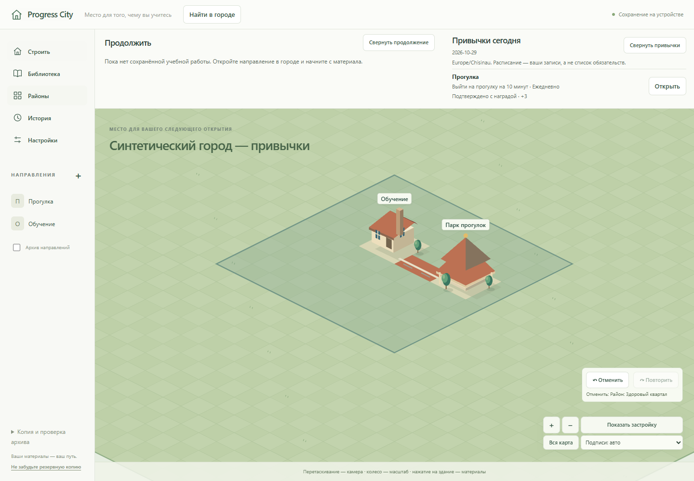
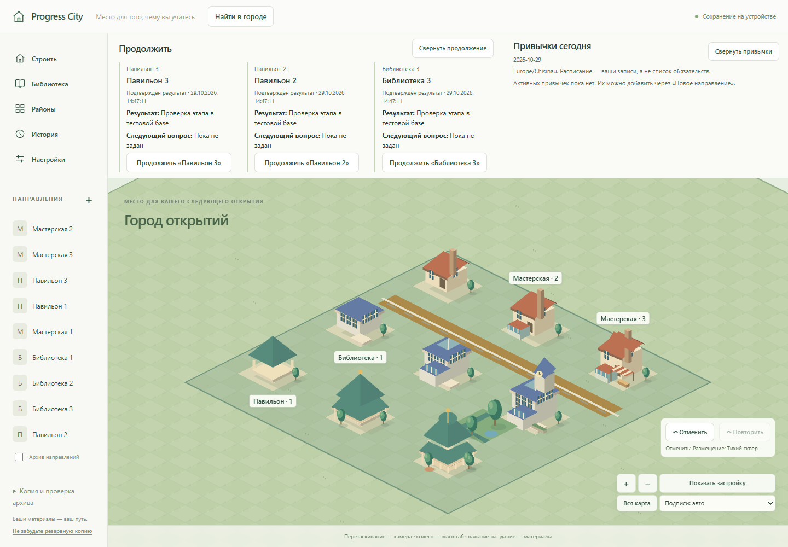

# Независимый обзор: город для привычек

**Последующая работа:** пользователь затем разрешил этапы0/1; PC-QA-004 и «Город на первом плане» реализованы/проверены в [CITY_FIRST_REVIEW](CITY_FIRST_REVIEW.md). Ниже сохранён исходный обзор/аудит075f2dd; остальные предложения ещё не реализованы.

29.10.2026. Проверенный код: **075f2dde744adeba4fa00538d891eee935db4c65**. Основание — свежие проверки, настоящий интерфейс dist, связанный код и два отдельных read-only обзора: городской конструктор и ежедневный маршрут привычек. Обозреватели не меняли файлы и не запускали параллельные тесты. Результаты и дефект PC-QA-004 — в [QA_RETEST_2026-10-29.md](QA_RETEST_2026-10-29.md).

Это **предложения**, а не реализованные функции или утверждённый новый релиз. Продуктовый код в этом задании не менялся. Выводы о желании возвращаться — гипотезы для личного пилота, а не обещание сформировать привычку.

## Вывод

Progress City уже работает как локальный дневник с настоящим городским конструктором: запись сохраняется, подтверждение даёт однократную награду, пользователь выбирает место и оформление, возвращается к материалам и восстанавливает архив. В новом синтетическом сценарии прогулка действительно стала собственным павильоном, дорогой и районом.

До ощущения долгой градостроительной игры больше всего не хватает **продолжения развития одной привычки, выразительных кварталов и удобного ежедневного входа из самого города**. Перечень функций уже большой; следующий шаг должен связать их в один приятный маршрут.

## Что уже стоит сохранить

- Самостоятельная планировка: дороги одним жестом, серийный декор, перенос, предпросмотр, отмена/повтор. Добавлять эти функции заново не требуется.
- Три архитектурных семейства с девятью различимыми этапами. При обычном масштабе видны пристройки, остекление, башня и сад; замена движка или переход на 3D сейчас не обоснованы.
- Примерка и оформление отделены от заработанного развития. Клик, новая фотография, перенос и длинная дорога не выдают учебную награду.
- Заметки, изображения, поиск и продолжение исследования придают постройкам содержание. Материалы доступны без здания.
- История и A/B показывают накопленные изменения. Сохранённый этап не подменяется сегодняшним, прошлые тексты не выдумываются.
- Локальное хранение, проверенный ZIP и отсутствие наказаний за пропуски. Город может быть местом возвращения после перерыва.

## Что взять из Cities: Skylines

В официальных описаниях Cities: Skylines II дороги и инструменты сетки помогают складывать постройки в кварталы; зонирование создаёт области разного характера; развитие открывает возможности, порядок которых выбирает игрок. Это полезные ориентиры для дизайна. Источники: [Road Tools](https://www.paradoxinteractive.com/games/cities-skylines-ii/features/road-tools), [Zones & Signature Buildings](https://www.paradoxinteractive.com/games/cities-skylines-ii/features/zones-signature-buildings), [Game Progression](https://colossalorder.fi/news/development-diary-10-game-progression/).

Моя адаптация для Progress City:

| Городской принцип | Как он мог бы работать здесь |
|---|---|
| Улица и квартал | Узнаваемое место из своих построек, дорожек, двора и озеленения |
| Характер района | «Движение», «Учёба», «Творчество»: собственные названия и выбранный облик, без оценки «правильной жизни» |
| Новые возможности | Подтверждённая деятельность со временем даёт выбор постоянного развития места |
| Наблюдение | Приблизиться к материалу, посмотреть район или сравнить путь за месяц |
| Жизнь в пространстве | Позднее — необязательные прохожие, свет и движение листвы как атмосфера |

Таблица — авторское предложение, не новая спецификация экономики. Для этого пригодна нынешняя изометрическая графика. Коммунальные аварии, налоги и расчёт трафика потребуют отдельной игры и будут отнимать внимание у дел вне приложения.

## Три основных приоритета

### 1. Продолжить городскую историю привычки после этапа 3

**Факт кода:** habit/reduce имеют этап направления 1/2/3 и не более одного связанного здания. После третьего этапа `upgrade` отказывает, но подтверждённые дни продолжают увеличивать баланс. Новые учебные объекты доступны навыкам/проектам; это не существующий способ расширять привычку. Основание: `src/domain/model.ts:39–40`, `src/storage/layout.ts:126–137`, `src/storage/service.ts:350–409`, `src/storage/learning.ts:12`.

При выборе результата с наградой +3 и стандартных ценах 3/6 все девять очков для двух улучшений дают три награждённые даты, с +1 — девять. Даты могут идти с пропусками; награда ограничена одной на локальный день. Это вывод из правил, а не проведённый здесь многодневный пользовательский эксперимент. После финального этапа остаются журнал, материалы и бесплатное обустройство.

**Гипотеза:** связь «сделал своё дело → получил новый городской выбор» слишком быстро заканчивается. Простое увеличение цен отложит тот же обрыв.

**Предложение отдельного дизайна:** после основного здания развивать принадлежащее привычке место постоянными дополнениями на выбор: садовый участок, двор, павильон. Игрок решает, что и где развивать. Каждое приобретение имеет основание; пропущенный день ничего не отнимает. Дополнения привычки не должны притворяться освоенными исследованиями, а старый бесплатный декор — внезапно стать платным.

Покупки, владение дополнениями, использование существующего баланса, предел карты и совместимость старых архивов нужно **согласовать отдельно**. Это выходит за текущий MVP и не входит в ближайший небольшой этап. Нельзя незаметно расширять ZIP/БД ради такого предложения.

### 2. Вернуть город в центр ежедневного действия

**Наблюдение интерфейса:** в большом синтетическом городе развёрнутые карточки «Продолжить» занимают значительную высоту; на 390 px застройка становится миниатюрой. «Показать застройку» включает далёкий декор и границы районов, поэтому внешнее озеленение уменьшает рабочее ядро. Это конкретный сценарий, а не утверждение о плохой камере при любом открытии. В A/B тот же набор выглядит крупнее. Основание: свежие PNG и `src/city/engine.ts:248–299,444–457`, `src/styles.css:1414`.

**Предложение:** компактная строка ежедневных входов с раскрытием, фокус на выбранном квартале/постройках прогресса, отдельный прежний обзор всей карты. Полный список направлений и скрытые подписи остаются доступными. Камера меняется по явному действию, сохраняется при работе с материалом; второй canvas не нужен.

**Факт маршрута привычки:** «Сегодня» уже подставляет дату/контекст и различает черновик, нулевую запись и награду. Далее открывается большая общая форма с учебными типами «Исследование / Проверка / Самостоятельное применение», определяющими +1/+2/+3. Собственное краткое описание результата обязательно; минуты, число и материалы необязательны. Нельзя называть все поля обязательной бюрократией. На проверенном снимке подтверждение находится ниже видимой области. См. `src/features/TodayPanel.tsx`, `src/features/ActivityForm.tsx:227–300`.

**Предложение:** краткий вид существующей формы привычки, дополнительные поля под раскрытием; после успешной записи — дата, фактические +0/+N и ясное действие «Улучшить», «Показать место» или «Поставить здание». На этапе 3 честно показать достигнутый предел. Использовать прежнюю Activity, команду подтверждения, награды и безопасный переход. Быстрая форма не должна молча выбирать большую награду, писать выдуманный результат или подтверждать при открытии.

**Гипотеза:** такой маршрут уменьшит усилие ежедневного ввода и укрепит связь с местом. Это проверяется пользованием, а не числом кнопок.

### 3. Строить улицы и дворы с узнаваемым характером

**Факт/наблюдение:** архитектура различима, но квартал часто читается как набор экспонатов на одинаковых подставках. Дороги уже рисуются жестом; рисунок клетки дороги в `src/city/art.ts:118–120` не получает сведения о соседях. Район редактируется именем/цветом и числовыми X/Y/шириной/глубиной (`src/features/Districts.tsx`). Смысл «прогулка» преимущественно передают имя и выбранный пользователем тип.

**Предложение первого шага:** производные от соседей прямые, окончания, повороты, Т-образные узлы и перекрёстки; единый край дорожки/тротуара и понятное примыкание участка к улице. Существующие клетки можно использовать без транспортной симуляции. Жест остаётся одной отменяемой операцией; A/B использует соответствующее историческое расположение.

**Дальше:** рисование прямоугольного района на карте через существующую модель, согласованные покрытия и озеленение, затем характерные наборы для выбранных пользователем тем. Новые размеры/ориентации построек — отдельным шагом с коллизиями и совместимостью старых городов. Дорога не становится обязательным условием записи материала или получения прежней награды.

Несколько хорошо соединяющихся элементов позволят построить улицу, двор и площадь. Десятки одиночных моделей на пустой сетке сами по себе город не создадут.

## Предложенный порядок работы

| Порядок | Ограниченная работа | Результат / граница |
|---|---|---|
| 0 | PC-QA-004: исходная редакция формы оформления + конфликт | Доверие к редактированию в двух вкладках; два воспроизведения сейчас RED |
| 1 | **«Город на первом плане»** | Компактные входы, явный фокус рабочего места, короткий маршрут и квитанция; без новой экономики |
| 2 | **«Связный квартал»** | Автосоединение рисунка дорог, примыкание, район на карте; без симуляции населения |
| 3 | **«Привычка после этапа 3»** | Отдельный дизайн долгого выбора развития, владения и совместимости сохранений |
| 4 | Атмосфера | Необязательные эффекты и жизнь на улицах; reduced motion, пауза в фоне, измерение ресурсов |

Оба независимых обозревателя поставили предел этапа 3 среди главных проблем; один предложил начать с пространства города, другой — с короткой отметки. Моя рекомендация — объединить их в небольшой этап №1, а долгий цикл проектировать отдельно. Он значим для будущего продукта, но затрагивает больше контрактов и не должен появиться случайно внутри UI-правок.

### Ближайшая итерация: «Город на первом плане»

Сценарий: открыть город → выбрать привычку/её место → оставить короткий собственный результат → явно подтвердить → увидеть сохранённую запись и доступное развитие → вернуться к прежней камере.

В границах предложения: компактный обзор, отдельный фокус рабочего квартала/зданий прогресса, краткий вид нынешней формы и обратная связь после сохранения. Один редактор и одна сессия автосохранения; прежние проверки изображений/ошибок/epoch сохраняются. Классификация и величина награды остаются видимыми. До реализации уточнить, как краткий вид объясняет выбор +1/+2/+3 без изменения правила.

Приёмка предложения:

1. Несколько привычек, плотное ядро и дальний декор: рабочие постройки можно показать одним действием; отдельная «Вся карта» остаётся.
2. На 1440×1000 и 390×844 компактные входы не перекрывают карту/управление, доступны с клавиатуры; полный список раскрывается. Камера не меняется от сохранения текста.
3. Из места открывается правильная запись локальной даты. Без здания доступна та же запись; вход ничего не создаёт.
4. Сохранение, отказ записи, ожидание изображения, нулевой день и повтор подтверждения показывают факт без новой награды и ложного успеха.
5. После reload доступны те же запись и материалы; A/B readonly; переключение вида не теряет ввод и не пересоздаёт сцену от символа текста.
6. Нет новых валют, этапов, учебных сущностей, изменений БД/ZIP и прежних начислений. Предел этапа 3 объясняется, а не маскируется.

## Что отложить

Полную транспортную/коммунальную симуляцию, новые валюты, население как оценку успеха, обязательные серии/уведомления, случайный лут, наказания за отдых, AI/backend и 3D. Атмосферные прохожие могут быть визуальным слоем; им не требуется постоянная симуляция жителей с записью каждого кадра.

Для постоянной городской жизни нынешний экономный renderer (`autoStart: false`) придётся использовать осмотрительно: ограниченная частота обновления/видимая область, reduced motion и пауза в фоне. Графика не должна ухудшать сохранение материалов и запуск.

Технический запас надёжности из прежнего roadmap актуален: аварийные черновики сейчас живут в памяти вкладки; постоянное восстановление, уборка неиспользуемых вложений и свежесть backup — отдельные задачи. Облачный сервер для личной версии не обязателен.

## Как проверить направление на себе

7–10 дней с одной-двумя настоящими привычками: удобно ли записывать честно, понятно ли основание развития, какое место хочется изменить следующим, остаётся ли смысл после последнего этапа. Пропуск — нормальный случай проверки возвращения. Эти дни не проделаны за пользователя и не помечены PASS.

Удачный критерий следующей версии: пользователь может показать свой квартал и объяснить, какие реальные дела за ним стоят и что он хочет обустроить дальше. Размер города, длина серии и количество зелёных тестов этого сами по себе не доказывают.
